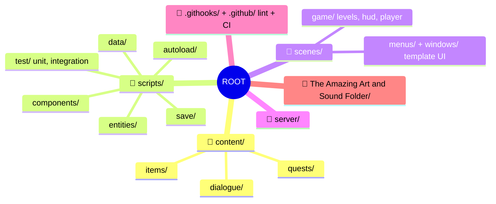
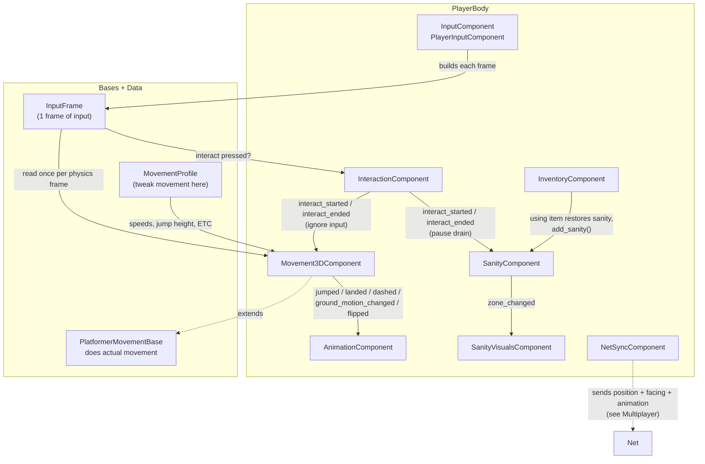
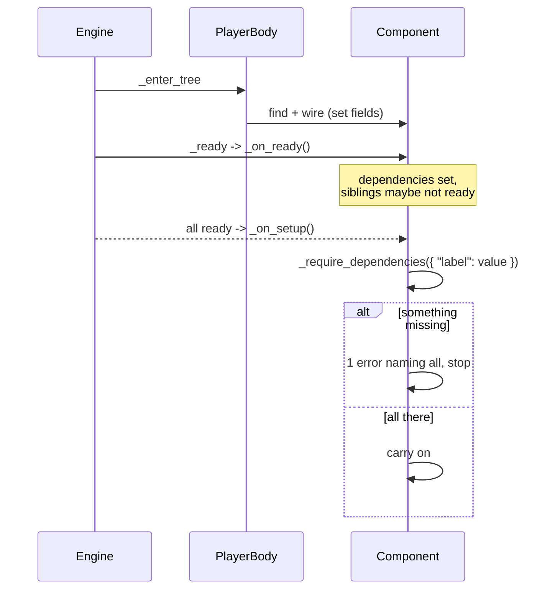
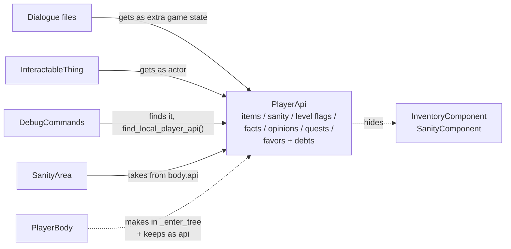
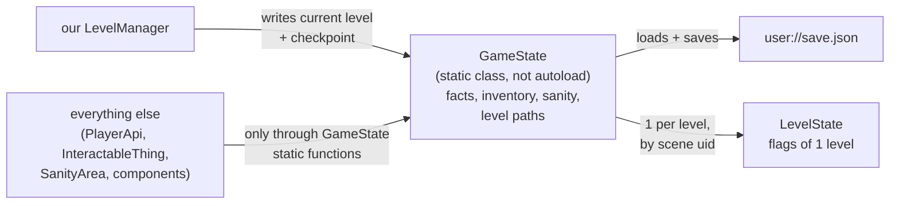
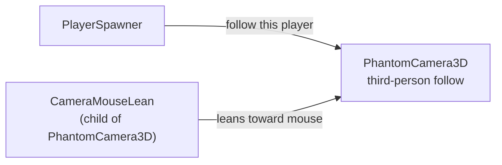
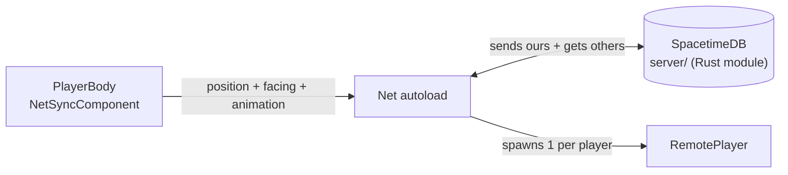
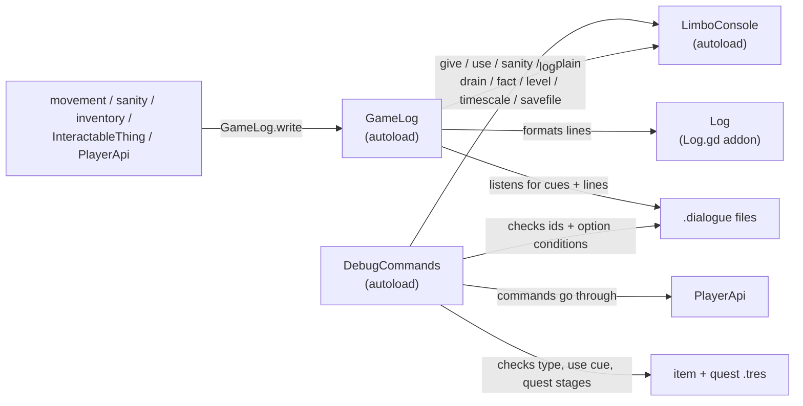
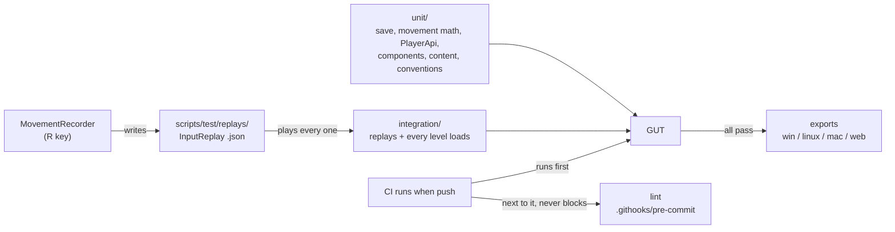
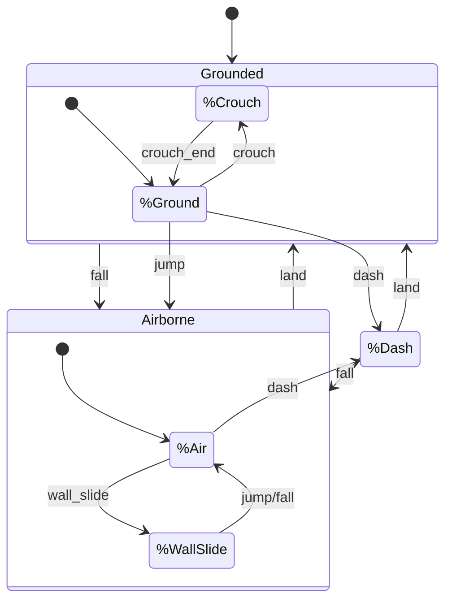

# Technical Design Document

> see also: [FDD](<./FDD.md>)

> [!NOTE] foreword
> this is for a 1 person programmer, maybe in the future more, but for now that is the constraint.
> this doc describes one way that works; it is not the only way. When deviating, update this doc

(codebase in a few lines:
easy to read, safe to rewrite, honest about what it does.)
## Content in Doc

- [Technical Stack](<#Technical Stack>)
	- [Addons](<#Addons>)
- [Project Layout](<#Project Layout>)
- [Adding New Stuff](<#Adding New Stuff>)
- [CORE Programming Rules](<#CORE Programming Rules>)
	- [FUNCTION NAMING](<#FUNCTION NAMING>)
	- [ANTIPATTERNS](<#ANTIPATTERNS>)
- [Rules for Documentation and Comments](<#Rules for Documentation and Comments>)
	- [API DOCS](<#API DOCS>)
	- [INLINE COMMENTS](<#INLINE COMMENTS>)
		- [HYGIENE](<#HYGIENE>)
	- [SYMBOLS](<#SYMBOLS>)
- [Game System Architecture](<#Game System Architecture>)
	- [Components (Extend Component, Wired by Body, Not Looked up Themselves)](<#Components (Extend Component, Wired by Body, Not Looked up Themselves)>)
	- [Component Wiring](<#Component Wiring>)
	- [Bodies and Spawner](<#Bodies and Spawner>)
	- [Player API](<#Player API>)
	- [Other](<#Other>)
	- [Game State and Level Management](<#Game State and Level Management>)
	- [Camera](<#Camera>)
	- [Multiplayer](<#Multiplayer>)
	- [Debug](<#Debug>)
	- [Tests and CI](<#Tests and CI>)
- [Technical Specifications](<#Technical Specifications>)

## Technical Stack

Godot 4.8, GDScript. Godot compatibility renderer(openGL), if more advanced features we use that then, not sooner. CI builds w/ 4.7.2, see [Tests and CI](<#Tests and CI>).
### Addons
- [Dialogue Manager 4.2.0](https://github.com/nathanhoad/godot_dialogue_manager/releases/tag/v4.2.0) - dialogue + choices : `DialogueManager` (autoload)
- [Antzs Debug Menu 1.3.0](https://github.com/antzGames/Antz-Debug-Menu/releases/tag/v1.3.0) - debug : `DebugMenu` (autoload)
- [Maaacks Game Template Addon 1.8.0](https://github.com/Maaack/Godot-Game-Template/releases/tag/v1.8.0) - level loading (`LevelManager`)
	- [Godot-UI-Sound-Controller 1.8.0](https://github.com/Maaack/Godot-UI-Sound-Controller/releases/tag/v1.8.0) : `ProjectUISoundController` (autoload)
	- [Godot-Scene-Loader 1.8.0](https://github.com/Maaack/Godot-Scene-Loader/releases/tag/v1.8.0) : `SceneLoader` (autoload)
	- [Godot-Music-Controller 1.8.0](https://github.com/Maaack/Godot-Music-Controller/releases/tag/v1.8.0) : `ProjectMusicController` (autoload)
- [phantom camera 0.11.0.4](https://github.com/ramokz/phantom-camera/releases/tag/v0.11.0.4) - camera : `PhantomCameraManager` (autoload)
- [sound manager 2.6.2](https://github.com/nathanhoad/godot_sound_manager/releases/tag/v2.6.2) - sound : `SoundManager` (autoload)
- [LimboConsole 0.8.0](https://github.com/limbonaut/limbo_console/releases/tag/v0.8.0) - debug : `LimboConsole` (autoload), `DebugCommands` (autoload)
- [Log.gd 0.3.0](https://github.com/russmatney/log.gd) - logging : `Log` (static class, no autoload), `GameLog` (autoload)
	- Reload Current Scene 0.1.0 - tool, came w/ Log.gd (no autoload)
- [SpacetimeDB Client SDK 0.3.3](https://github.com/flametime/Godot-SpacetimeDB-SDK/releases/tag/v0.3.3) - multiplayer : `SpacetimeDB` (autoload)
- [GDScript Formatter 0.28.0](https://github.com/GDQuest/GDScript-formatter/releases/tag/0.28.0) - tool (no autoload)
- [health, hitboxes and hitscans 5.0.4](https://github.com/cluttered-code/godot-health-hitbox-hurtbox/releases/tag/v5.0.4) - future health? (no autoload)
- [Godot State Charts 0.22.5](https://github.com/derkork/godot-statecharts/releases/tag/v0.22.5) - movement states (no autoload)
- [Script-IDE 2.2.5](https://github.com/Maran23/script-ide/releases/tag/v2.2.5) - tool (no autoload)
- [Plugin Updater 0.5.1](https://github.com/Maaack/Godot-Plugin-Updater/releases/tag/v0.5.1) - tool (no autoload)
- [Project Time Tracker 3.0.1](https://github.com/Fifut/project-time-tracker/releases/tag/v3.0.1) - tool (no autoload)
- [GUT 9.7.1](https://github.com/bitwes/Gut/releases/tag/v9.7.1) - unit tests (no autoload)

only `GameLog`, `DebugCommands` + `Net` autoloads are ours.

> Server: [see Multiplayer.](<#multiplayer>)

- `GameState` is static class, not autoload -> `GameState.save()` can be called from anywhere, order doesnt matter.
- `LimboConsole` should stay above `GameLog` + `DebugCommands`, bc those add their commands in `_ready`.

## Project Layout



## Adding New Stuff

start here. most new stuff = file in `content/` or small scene, not new code.

- **item / quest** = `.tres` in `content/items/` / `content/quests/`, id = file name. renaming breaks saves. -> [Game State and Level Management](<#Game State and Level Management>)
- **thing you can touch** (pickup, door, sign) = `interactable_thing_prefab.tscn`, or `Node3D` scene with `InteractableThing` on root. reach = its `Area3D` child, none = sphere built in `_ready` (physics layer 5).
	- `persistent_id` = stays gone after reload, `requires_item` / `requires_flag` + `blocked_cue` = locked.
- **npc / dialogue** = `InteractableThing` + `dialogue` + `dialogue_cue`. 1 `.dialogue` per character, objects in `world.dialogue`. only calls `PlayerApi`. -> [Other](<#Other>), [Player API](<#Player API>)
- **remembering choice** = no code: `$> set_fact("choice.<what>")` / `set_level_flag("<level>.<what>")`. key starts with who wrote it. -> [Game State and Level Management](<#Game State and Level Management>)
- **something dialogue cant do** = 1 narrow method on `PlayerApi`, no new global (rule 9).
- **place that heals / eats sanity** = `SanityArea`. -> [Game State and Level Management](<#Game State and Level Management>)
- **player ability** = component extending `Component` in body scene, wired by body, talks through signals. -> [Components](<#Components (Extend Component, Wired by Body, Not Looked up Themselves)>)
- **HUD widget** = small scene in `scenes/game/hud/`, finds player itself, add to `hud.tscn`. -> [Other](<#Other>)
- **level** = scene in `scenes/game/levels/` + path in `SceneLister` `files` (`game.tscn`), also what console `level` lists.
- **saved field** -> "new saved field" in [Game State and Level Management](<#Game State and Level Management>).
- **console command** = `LimboConsole.register_command` in `DebugCommands._ready`, through `PlayerApi`. -> [Debug](<#Debug>)
- **log channel** -> "new channel" in [Debug](<#Debug>).
- **test** = script in `scripts/test/unit/` (no scene) / `integration/` (loads level), new from `GutTest` script template. touches save -> extends `SaveIsolatedTest`. -> [Tests and CI](<#Tests and CI>)
- **movement regression test** = no code: record replay in showcase (R). -> [Tests and CI](<#Tests and CI>)
- **script** = SPDX header on top, EUPL-1.2 compatable.

## CORE Programming Rules
GAME DEV CORE PROGRAMMING AND CODING PRINCIPLES

1. main design pattern (but not only one present): 
	- *godot flavored component-based architecture*
		- but its not perfect, consider this:
		- components add  complexity over simply making a class, and communication between components becomes more challenging.
		- making everything components is stupid, some things can just be classes or such.
	- over-application can be solved with the golden rule, everything in balance. even the rule itself. (*applies to all rules*)
2. if considering abstraction, also consider deletion or merging scripts into one.
	- First of all trying to keep it simple, but secondly when adding complexity how much benefit is coming from that complexity?
	- is this abstraction earning its keep?
3. Fail loudly.
	- A bad item ID should call `Log.error` (prints file + line, then calls `push_error`). warnings use `Log.warn`.
	- Never continue silently.
	- check early: at load/setup, not when player gets there. code checks own assumptions (`_require_dependencies`, `SanityComponent` thresholds order, state chart events, dialogue ids + cues, item + quest `.tres`, ETC) ∴ broken scene/content errors on first run.
4. Clear, descriptive names over shortened or abbreviated names.
	- [mostly relevant for functions, but not only.](<#function naming>)
5. Signals up, methods down.
6. Event driven.
	- react to signals, dont poll every frame when signal exists.
7. small, composable scenes, not a framework layered on top.
8. Separate machine-independent and machine-dependent code.
	- Thats what makes the code hackable, not cleverness.
	- `PlatformerMovementBase`, with its abstract 2D and 3D functions, is example.
9. Use narrow interfaces where change is expected.
	- `PlayerApi` (`give_item`, `has_item`, `set_level_flag`, `set_fact`, etc.) hides components, so you can rewrite them without touching dialogue files.
10. Make code easy to grep.
	- Use one class per file, name file after class, and use stable IDs (item ID is the file name).
	- Names shared between code and scenes/addons are `StringName` constants (`Animations`, `StateEvents`), never typed-out strings in code
11. Write the minimum, Less code is a feature.
	- Add a narrow interface only where you already expect change.
12. if not necessary, make sure not to handroll our own logic, use godots inbuilt logic and functions and methods instead.
13. AUDIT, REVIEW, REPEAT:
	- make sure old code is up to date with current codebase/code conventions, design patterns could have changed, things evolve and change.
	- make sure stuff doesnt get left behind
14. Static typing everywhere.
	- every var, parameter + return has a type. types are docs that cant go stale.
	- `project.godot` only warns (`untyped_declaration`, `inferred_declaration`, `unsafe_*`) ∵ Maaack template scripts are untyped. `addons/`, `ARCHIVE SCRIPTS`, `godot_state_charts_examples` + `spacetime_bindings` excluded.
	- our code (SPDX header) = `test_code_conventions` fails on every untyped var, parameter, return, `for` + `:=`. -> [Tests and CI](<#Tests and CI>)
15. Shared resources are read-only.
	- `.tres` + scene sub-resources are 1 object for every instance using them. change at runtime = changes all ∴ `duplicate()` first (see [INLINE COMMENTS](<#INLINE COMMENTS>) example).
16. GENERAL, keep code like:
	1. suckless; Simpel, Clarity, frugality and small enough for one person to read and rewrite. (can't maintain if can't understand)
	2. netbsd; easy to inspect, modify, and extend.
	3. openbsd; simple, clear, and consistent.

### FUNCTION NAMING
- Descriptive names. Longer is good when clearer.
	- `add()` -> `add_inventory_item()`
- Full words.
	- `_read_move()` -> `_get_movement_input()`
- Name the actual behavior.
	- `_find_closest()` -> `_find_nearest_interactable()`
- Add system/target/result when it clarifies.
	- `get_ratio()` -> `get_current_sanity_ratio()`
- Readable at call site.
	- `run(by)` -> `execute_interaction_for_actor(actor)`
- Related names consistent.
	- `pause()` -> `pause_sanity_drain()`, `unpause()` -> `resume_sanity_drain()`
- Context from class alone isnt always enough.
	- `set_value()` -> `set_current_sanity_value()`
- No filler words.
	- `get_frame()` stays `get_frame()` when it returns `InputFrame`.
- Rename declarations, overrides, call sites together.
- Preserve Godot-defined method names.
- `_` prefix = private, only own class calls it.
- signals = what happened, past tense.
	- `jumped`, `depleted`, `add_failed`
- bool state reads as yes/no question.
	- `_is_busy`, `can_jump`, `_has_been_entered`

### ANTIPATTERNS
dont -> do instead. if catch yourself doing left, FUCKING STOP.

- component finds own dependencies (`get_node("../Movement")`) -> body wires it. ([Component Wiring](<#Component Wiring>))
- movement reads `Input` directly -> `input_component.get_frame()`. else replays + tests cant drive it.
- `if not item: return` -> `Log.error` + return. silent = bug you find 3 weeks later. (rule 3)
- typed-out names (`play("jump")`, `send_event("land")`) -> `Animations.JUMP`, `StateEvents.LAND`. (rule 10)
- dialogue touching `api.inventory` / components -> method on `PlayerApi`. (rule 9)
- new autoload for 1 feature -> method on `PlayerApi` or static class. (rule 9)
- checking value every frame when signal exists -> connect to signal. (rule 6)
- changing `.tres` / `profile` at runtime -> `duplicate()` first. (rule 15)
- tuning numbers in code -> `MovementProfile` / `@export`.
- `-1` / magic value meaning "not set" -> bool (`has_sanity`).
- renaming item `.tres`, fact key or `persistent_id` -> dont, else bump `SAVE_VERSION` + migrate. ([Game State and Level Management](<#Game State and Level Management>))
- base class / manager / abstraction "for later" -> write it when 2nd user exists. (rule 2, 11)

## Rules for Documentation and Comments
GAME DEV DOCUMENTATION AND COMMENT PRINCIPLES

- Self-documenting code first: names (rule 4), types (rule 14) + constants (rule 10) say what. comments only say what those cant.
- Comment the surprising, not the obvious with inline comments.
- be direct and concise, skip the word "the" and "a" and apostrophes even if its less pretty (keeps things more direct)
	- use symbols over words, even if less readable, see [SYMBOLS](<#SYMBOLS>)
- Explain why, not what.
- Code shows what it does. Comments show reasoning, decisions, xor constraints.
- Code documents implementation; comments document intent.
	- If intent changes, update comment.
- Dont duplicate code in comments.
	- If a comment just restates code, delete it.
- Use two comment types, two jobs.
	- Double-hash doc comments for public API docs (shown in editor and shown in class reference).
	- Single-hash comments for inline implementation notes

### API DOCS
Use double-hash doc comments for public functions, signals, `@export` variables, `class_name`, and modules. Doc comment must sit above the member it documents.

- `#` = why. `##` = public API contract (shows in editor). Dont mix.
- Document the contract: what it does, parameters, return values, and side effects.
- Link related symbols with `[member health]`, `[method take_damage]`, `[signal died]`. (become clickable in editor.)
- Add short usage example for non-trivial functions.

Example:
```gdscript
## Emitted when facing changes.
signal flipped(new_facing_x: float)

## Replaces save w/ file at [param path]. Returns false + changes ∅ when file ≠ save.
static func import_save(path: String) -> bool:
```

### INLINE COMMENTS
Use single-hash comments inside function bodies.

- Good: engine workarounds, ordering requirements, magic numbers, and warnings like "changing this breaks saves".
- Write for future fixer and extender.
	- Explain invariants, pitfalls, and non-obvious choices.
- Keep them short.
	- Long explanations belong in API docs or this doc.

Example:
```gdscript
# own copy: height changes at runtime + scene shape resource is shared by every instance
_capsule = _capsule.duplicate()
```

#### HYGIENE
- Fix code, not comments.
	- Dont use comments to patch bad names or messy GDScript. Rewrite it.
- Update outdated doc comments.
	- Editor hover and class reference will show stale docs. An incorrect comment is worse than no comment.
- Be consistent.
	- inline `#`: lowercase, no period at end, above code.
	- doc `##`: capital letter, end with period.
	- class names + identifiers keep their case (`DirAccess`, `JSON`, `_ready`).

### SYMBOLS
Used in both `#` and `##`. Not inside `[code]`, `[codeblock]` or quoted strings.

| symbol | word | example |
| --- | --- | --- |
| `+` | and | `refills jumps + dashes` |
| `/` | or, per | `respawn/level change`, `one step /version` |
| `∴` | so, therefore | `leave cleanly ∴ server drops our row at once` |
| `>` | then | `spawn remote if missing > apply` |
| `∵` | because | `read here ∵ addon reparents camera` |
| `≠` | is not (between two things) | `when file ≠ save` |
| `≈` | about | `≈10 for default jump` |
| `⚠` | warning | `## ⚠ Renaming key breaks saves.` |
| `∅` | nothing, empty, none | `Warns + saves ∅ w/o game state.` |
| `w/` `w/o` | with, without | `w/o game state` |
| `>=` `<=` | at least, at most | `length <= 1` |


## Game System Architecture
(architecture inspired by <https://gameprogrammingpatterns.com> and others i need to link)
### Components (Extend Component, Wired by Body, Not Looked up Themselves)



context; (what player actually does, see [FDD](<./FDD.md>))

- Input: read once per physics frame into an `InputFrame`, and `InputComponent.get_frame()` hands everyone that same frame. 
	- `PlayerInputComponent` remembers presses + releases from input events, held buttons are polled.
	- `InputComponent` on its own plays its `frames` array back, 1 /physics frame. `PlayerInputComponent` does same when `frames` is set -> replays + tests drive real player. -> [Tests and CI](<#Tests and CI>)
- Movement: state chart decides which state is active (Grounded: Ground/Crouch, Airborne: Air/WallSlide, Dash). `PlatformerMovementBase` does physics for that state + sends `StateEvents` back to chart.
	- math that only needs parameters (jump, gravity, acceleration, wall jump) = static funcs in `#region Pure math` ∴ tests call it w/o body/scene.
- Facing: `PlatformerMovementBase` keeps `facing` (-1/1) + emits `flipped` when input x turns around. no input x = keeps old facing. start = `default_facing_right`.
- 3D player uses `AnimatedSprite3D` (2D art on 3D plane).
- Animation: names are constants in `Animations`, and its all driven by movement signals.
- Interaction: `InteractionComponent` runs the closest `InteractableThing` player is standing in zone of. 
	- if that thing locks player it emits `interact_started` / `interact_ended`, -> movement ignores input + sanity stops draining while its busy.
- Sanity: `SanityComponent` keeps value + zone. (code `zone` = sanity **stage** in GDD/FDD, not world zone) 
	- `SanityVisualsComponent` listens to `zone_changed`, so the meter itself knows nothing about visuals.
	- per zone it greys, darkens + warps the screen (shader) and shakes the 3D camera. shake goes through `Camera3D.h_offset` / `v_offset`, bc phantom camera owns the transform. at full sanity it stops processing, zone change wakes it.

### Component Wiring

Two hooks run in order:

1. `_on_ready` runs inside `Node._ready`. Dependencies already set, but sibling `_ready`s may not be.
2. `_on_setup` runs deferred (idle time after all `_ready`s). Check dependencies here with `_require_dependencies({ "label": value })`, which collects every null into 1 error + returns true/false so component can bail out.



`PlayerBody` is the only place dependencies are assigned. It runs in `_enter_tree`, finds every component + sprite with `Component.find_descendant_of_type(self, Type)`, assigns typed fields before hooks run. 
If component is missing body just skips it. Dependency injection, not a service locator. 
Missing wiring is reported once, in `_on_setup`, by every component that depends on it.

Hooks dont call their parent on their own. if component extends `Component` directly it needs no `super()`, but if it extends another component (like `Movement3DComponent`) it must call it.

Components communicate through signals (`jumped`, `landed`, `dashed`, `flipped`, etc.). 
Input is read once per physics frame into an `InputFrame`, so movement never reads `Input` directly. 

### Bodies and Spawner

- `PlayerBody` is god and wires all components.
- `PlayerSpawner` (`Marker3D`) spawns player scene as its own child in `_enter_tree` + tells its `camera` to follow that player.

### Player API



Not autoload. Body creates it in `_enter_tree`, keeps as `api` + joins group `player`. thats how `PlayerApi.find_local_player_api(tree)` finds.

`InteractionComponent` gives to `InteractableThing` as actor, and that one gives to dialogue as extra game state (never as global). 
Dialogue files and `InteractableThing` should only call its methods, that way components can be rewritten without touching dialogue files. 
other code (`DebugCommands`, `SanityArea`, HUD) is allowed to read `api.inventory` + `api.sanity` directly.

Quest stage, NPC opinion, favors and debts are "just": `quest.<id>` + `opinion.<npc>` + `favor.<npc>` (they owe you) + `debt.<npc>` (you owe them). prefixes = `PlayerApi` constants (`QUEST_FACT_PREFIX`, ETC), `.dialogue` files still type keys out.

### Other

- Dialogue: talk to NPCs with Dialogue Manager. 1 file per character + 1 `world.dialogue` for objects, all in `content/dialogue/`.
	- mutations use `$>` (`do` + `set` are deprecated in 4.x).
	- design notes = `##` doc comments above line or option they are about. Dialogue Manager keeps them on the compiled line, shown only by `explain`.
	- `scenes/game/dialogue_balloon.tscn` = example balloon + 2 tags, right after character name. text itself stays same. use them rarely.
		- `[#sanity_glitch]`: text trembles + flickers.
		- `[#jumpscare]`: `jumpscare_texture` (+ optional sound) slams over screen for a moment.
- Items and Quests: `ItemData` + `QuestData` resources. quest itself holds no progress, that is fact `quest.<id>`.
- HUD: `scenes/game/hud/hud.tscn`, made of small widget scenes (`SanityMeter`, `InventoryList`, `ControlsLabel`, `PickupToast`, `DebugStateLabel`, `ExplainFeed`). each finds the player itself + listens to its signals, so a level can use only some of them.
	- `ControlsLabel` reads keys from the input map -> remapped keys show (after level reload).
	- `DebugStateLabel` shows every fact, off by default (`show_debug_state` on the HUD), polls bc facts have no signal.

### Game State + Level Management



- everything reads + writes through static functions in `GameState`, setting something = saved immediately.
	- except sanity; changes every physics frame -> only copied into `GameState` (`mirror_sanity`) + file gets written when `SanityComponent` leaves tree. `has_sanity` false until first copy, then `get_saved_sanity` returns its default.
	- getters dont hand out live data: `get_all_facts` = copy, `get_level_state` only reads + null for level never reached.
	- `get_or_create_level_state` creates + saves, that counts level as reached (`level.gd` calls it). returned `LevelState` is live: change field > `GameState.save()`.
- when running scene straight from editor theres no game state -> default values + nothing saved.
- facts are global and their keys start with what wrote them: `choice.`, `opinion.`, `quest.`, `favor.`, `debt.`. level flags are per level: `thing.<persistent_id>`, `sanctuary.<persistent_id>`.
	- fact value = bool, int, float or String. anything else errors + isnt saved.
- save = JSON in `user://save.json`, written by `GameState.save()`.  (.tres could run foreign code)
	- written to `save.json.tmp` first, then moved over the real file -> crash mid write keeps old save.
	- file that = not valid JSON get renamed to `save.json.broken` + game starts fresh.
	- JSON has 1 number type -> whole numbers in facts are turned back into int on load.
	- only `to_dictionary`, `from_dictionary`, `save` + `_read_save_file` know format.
- options menu, Game tab: Export copies save to file you pick, Import replaces save with picked file (`GameState.export_save` / `import_save`). import keeps old save as `save.json.backup`, migrates older versions + reloads the scene.
- new saved field: default in `GameState` + line in `to_dictionary` + `from_dictionary`.
- if changing what saved data is (renamed fact key, reordered quest stages), bump `SAVE_VERSION` + add step in `_migrate_save_to_current_version`. steps change plain data from the file, before it becomes `GameState`.
	- + old save as fixture in `scripts/test/fixtures/` (`save_v1.json` ETC) + test that it migrates. -> [Tests and CI](<#Tests and CI>)
- items + quests are saved by id -> renaming `.tres` breaks every save that has that.
- `InteractableThing`: optional `persistent_id` keeps `free_after` pickups gone after reload.
- `SanityArea` changes sanity drain while player inside. default = sanctuary: pauses drain + gives entry bonus. with optional `persistent_id` entry; bonus stays used after reload.
	- `pauses_drain` off + `extra_drain_per_second` = thing that eats sanity when you stand close.
	- flag key is still `sanctuary.<persistent_id>`, renaming it breaks saves.

### Camera



> how camera should feel for player: see Camera [FDD](<./FDD.md>).

- `CameraMouseLean` must be child of `PhantomCamera3D` in third-person follow mode, if not errors + does nothing.
- damping + spring arm length tweaked per level on `PhantomCamera3D`, not in code.
- lean tweaked in `CameraMouseLean` export.

### Multiplayer



- only `Net` touches `SpacetimeDB.Faerie`. `FaerieNetPlayer` rows are also read by `RemotePlayer`.
- Offline still works if connection fails (why tf would it not? idiots bad desin probbly, or in case of corpos; Greed)

### Debug



- every time you run from the editor, `DebugCommands` checks all `.dialogue` files and gives error for item + quest ids that dont exist (rule 3). it only sees ids that are typed. `test_content` runs same checks in CI.
	- `InteractableThing` checks on load that its `dialogue_cue` + `blocked_cue` exist in its `.dialogue`.
	- same check gives error for option conditions that dont end in ` /]`: with plain `]` the condition is shown as option text + never checked.
	- facts have no list ∴ only shape is checked: key = `<who>.<what>`, lowercase.
	- tags (`[#sanity_glitch]`) must be in `DialogueBalloon.TAGS`
	- checks every `.tres` in `content/items/` + `content/quests/`: right type, item `use_dialogue_cue` exists, quest has title + >= 1 stage.
- other load checks: duplicate `persistent_id` in level (`InteractableThing`, `SanityArea`), `SanityArea` w/o shape/player layer 2, player sprite missing an `Animations` name. `requires_flag` nothing sets is caught by `test_levels_load`.
- `GameLog.write(&"channel", ...)` logs what player does: one line at place where happens. channels: `movement`, `sanity`, `inventory`, `interact`, `dialogue`, `ledger`. value in `GameLog.channels`. `GameLogSettings` on `game.tscn` root overrides those in inspector when game starts from menu. console `log <channel>` flips one until you quit, `log` lists them.
	- lines go to godot output, the console + godot log file (`user://logs/godot.log`).
	- log changes, not frames: sanity drain + held direction are not logged every tick.
	- new channel = new key in `GameLog.channels`, unknown channel is an error.
	- `dialogue` channel needs no calls: `GameLog` listens to `DialogueManager` signals for cues + lines, `DialogueBalloon` writes picked option.
	- errors + warnings dont go through `GameLog`, they use `Log.error` / `Log.warn` (rule 3).
	- Log.gd log level above INFO (WARN, ERROR) mutes channels too, not only `Log.debug` / `Log.info`.
	- console `log` is ours, LimboConsole own `log` command is unregistered.
	- Log.gd timestamps only in release export (`log_gd` in project settings) ∴ log files from players are dated.
	- `Log.pr(thing)` prints `thing.to_pretty()` when it has one -> `GameState` + `InputFrame` print as dictionary, not object id.
- console `explain` turns on `ExplainFeed` (HUD). it shows every `sanity`, `inventory` + `ledger` line from `GameLog.wrote`, `##` notes of current line, + condition of every locked option. -> `.dialogue` files never say what a line did, game already knows.
	- `GameLog.wrote` fires for channels that are off too, only formats when something listens.
- cheats: `drain` stops sanity drain of current player, `fact <key> <value>` sets a fact, `level <number>` loads level (no number = list), `timescale <value>` for slow motion, `savefile` shows the save in the file manager.
- state charts:
	- F3 (`DebugMenu`) triggers state chart debugger for local player, active states + event history. 
	- player charts have `track_in_editor` on -> run from editor, Debugger panel > State Charts tab shows live chart.

### Tests + CI



- bug fix starts w/ test/replay that fails on that bug, then fix. new logic (save, `PlayerApi`, components) gets its test first. feel (movement tuning) is tuned first + guarded by replay after.
- GUT, tests live in `scripts/test/`. dirs + settings in `.gutconfig.json`. GUT fails test on any `push_error` ∴ every `Log.error` that fires during test fails it, expected = `assert_push_error`.
	- `unit/` = no scene:
		- save round trip + migration, fixture /old `SAVE_VERSION`.
		- static movement math (`#region Pure math`, uses `MovementProfile` defaults ∴ tuning player profile changes ∅ there).
		- behaviour of `PlayerApi`, inventory, sanity, `InteractableThing`, `SanityArea`, `InputReplay` round trip. nodes made in code.
		- `test_fail_loudly` = rule 3 error paths. `test_content` = `DebugCommands` content checks.
		- `test_code_conventions` = rules grep can check on our scripts (SPDX header, Maaack templates have ∅ ∴ skipped): SPDX, 1 class /file named after it, components wired by body + extend `Component`, only `PlayerInputComponent` reads `Input`, no typed-out names, `##` on public members, typing (rule 14), `_private` stays in own class, `GameLog` channels exist, no `@warning_ignore`. judgment rules stay review work.
	- `integration/` = loads levels:
		- `test_movement_replay` = showcase + scripted moves (jump height, walk/run speed, facing) + every recorded replay.
		- `test_levels_load` = every level in `SceneLister` (`game.tscn`) runs w/o error + has player, every `requires_flag` is set somewhere.
	- tests that touch save extend `SaveIsolatedTest`: own `user://test_save.json`, ∅ save before each test ∴ real save is never touched.
- movement replays: `MovementRecorder` node in showcase.
	- run showcase from editor, R = level restarts + records, R again = saved as `replay.json`. rename to what it tests.
	- R = off in export (writes `res://`) + in tests.
	- `InputReplay` = 1 `InputFrame` /physics frame + body position after it. other `VERSION` = refused, record again.
	- `test_movement_replay` fails when player drifts more than `POSITION_TOLERANCE` from recorded path. movement changed on purpose -> delete failing replay + record again.
	- only movement is replayed, dialogue/UI  not ∴ interaction is off while recording + replaying. moving spawner/geometry where replay passes breaks it.
- CI = `.github/workflows/godot-ci.yaml`, every push to master. tests first, exports only when they pass (failed test = no broken web deploy).
	- tests run w/ `-- --offline` ∴ `Net` doesnt connect. ([Multiplayer](<#Multiplayer>))
- lint = `gdscript-formatter lint` on every project `.gd`. `.githooks/pre-commit` runs it, CI runs same script.
	- enable once /clone: `git config core.hooksPath .githooks`. skip once: `git commit --no-verify`.
	- excluded: addons, generated bindings, archive, script templates + 3 Maaack template files. list in hook must match format on save skips in `.editorconfig`.

## Technical Specifications

Game makes use of Godots API (`CharacterBody3D`, `Resource`, signals) plus addons listed above.

- Movement values tweaked in `MovementProfile` resource, not .gd
- State charts nodes must have unique names `%Ground`, `%Air`, `%WallSlide`, `%Dash`, `%Crouch` + in same scene as movement component. Chart is injected.
- transition events in player scene must be same as `StateEvents` constants. `PlatformerMovementBase` errors on load for transition event that isnt one of them.
- states grouped in `Grounded` + `Airborne`. `fall` on `Grounded` + `land` on `Airborne` sit on group, not on each child: event goes up to parent when active child has no transition for it.
- chart only picks state, code sends event. no delays/guards: delays tick in `_process`, not physics ∴ replays would drift. coyote time, jump buffer, dash duration = timers in code.


**Performance**

- web should be 45 FPS minimum (see Performance [FDD](<./FDD.md>)). if do; other platforms are automatically optimised as well

> see [FDD](<./FDD.md>) for User acceptance tests